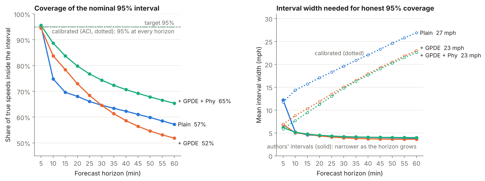
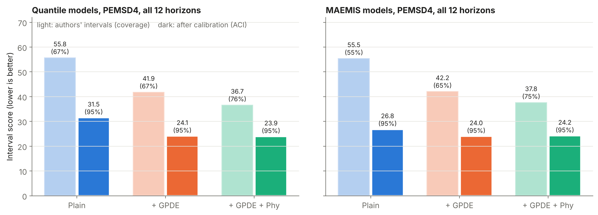
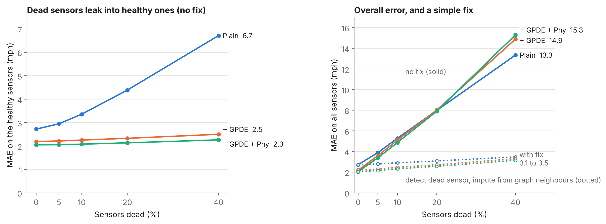
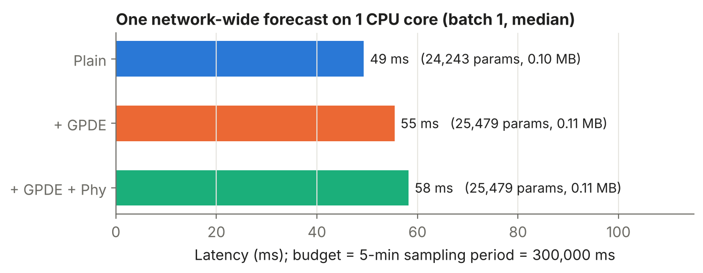

# extensions/: calibration, sensor failures, latency

Three experiments the paper does not do, each tied to a critique point:

| Script | Question | Critique point |
|---|---|---|
| `coverage_conformal.py` | Do the "95%" intervals contain the truth 95% of the time? Can conformal calibration fix them? | 9: "calibrated" is claimed but coverage is never measured |
| `sensor_failure.py` | What happens when loop detectors go dead or stuck, and does a simple detect-and-impute step help? | 10: gradient attacks only, no realistic faults |
| `latency.py` | How fast and how big is the model on a CPU, against the 5-minute sampling period? | 11: no timing, memory or deployment analysis |

All experiments use the authors' shipped PEMSD4 checkpoints (Quantile epoch 18, +GPDE epoch 18, +GPDE+Phy epoch 19; MAEMIS models from the shared prediction files) and the PEMSD4 test split (3376 samples, 307 sensors), scored without the authors' padded samples.

| File | What |
|---|---|
| `checkpoint_utils.py` | loads the authors' checkpoints outside their training code (any batch size, CPU or GPU) |
| `make_predictions.py` | saves validation and test predictions of those checkpoints in the format `coverage_conformal.py` reads |
| `make_figures.py` | builds every figure in `figures/` from the CSVs in `results/` |
| `calibration_failure_latency.ipynb` | runs everything on Colab |
| `results/` | all result CSVs (see the table at the end) |
| `figures/` | slide figures |

## Results

### 1. The 95% intervals are not calibrated; conformal calibration fixes them

- The authors' intervals are calibrated only at the first step (5 min: 95.4 / 94.5 / 95.6% coverage for Quantile / +GPDE / +GPDE+Phy). From 10 min on they get narrower while the error grows, so coverage falls to 57 / 52 / 65% at 60 min. Over all 12 horizons: 66.7 / 66.5 / 75.9%; the MAEMIS models: 54.9 / 65.0 / 75.3%.
- Worst in congestion (true speed below 40 mph, 3.2% of test points): 14 / 43 / 50% coverage.
- All three conformal methods restore 95% on the test split: ACI 95.0%, CQR and per-sensor CQR about 96%. The honest intervals are 3.2 to 4.6 times wider (about 23 mph at 60 min for the GPDE Quantile models, 27 mph for the plain one), yet the interval score improves by 35-52% (ACI), because the raw intervals miss so often.
- Per sensor: 90-100% of sensors cover under 90% with the raw intervals; 7-9% after one CQR correction per horizon; at most 1% with per-sensor CQR; none with ACI.
- Limit: the guarantee is on average, not per situation. In congestion, calibrated coverage is 61-78%, still below 95%.

- **The physics loss's interval advantage disappears after calibration.** Raw interval score: +GPDE+Phy beats +GPDE by 12% (Quantile, 36.7 vs 41.9) and 10.5% (MAEMIS, 37.8 vs 42.2). After ACI: 23.9 vs 24.1 (Quantile) and 24.2 vs 24.0 (MAEMIS, i.e. slightly worse). Across all calibration methods and horizons, the raw 9-13% advantage shrinks to within ±3%, with one exception: for Quantile at 15 min +Phy keeps a 3-7% advantage. For MAEMIS, +Phy is worse in every calibrated case (by 0.5-3.3%). Most of the reported advantage comes from how miscalibrated each model's raw intervals are. The +GPDE gain over the plain model survives calibration (31.5 → 24.1 Quantile, 26.8 → 24.0 MAEMIS).

Sources: `results/coverage_conformal_metrics.csv` (own predictions, 3 Quantile models), `results/coverage_conformal_metrics_shared_predictions.csv` (team prediction files, 6 models). For the 3 Quantile models the two files agree to within 0.00002 coverage and 0.003 mph width in all 312 rows. "Interval score" = standard MIS, (u − l) + (2/α)·miss distance; the authors' "MIS" (standard MIS + MAE) is the `MIS_authors` column.

### 2. Dead sensors spread through the graph in the plain model; a simple fix removes almost all the damage

- Dead sensors (input reads 0), no fix, 3 random sensor sets: at 40% dead, MAE on the *healthy* sensors rises from 2.72 to 6.72 mph for the plain model, but only from 2.19 to 2.50 (+GPDE) and 2.05 to 2.26 (+GPDE+Phy). The GPDE layer stops the zeros from leaking into healthy sensors, a robustness benefit the paper does not mention. The physics loss adds little on top of GPDE.
- On the dead sensors themselves every model fails: MAE 23-35 mph, coverage 2-3%.
- Fix: flag a sensor-window as dead when all its inputs are 0, replace its inputs by the weighted mean of its healthy graph neighbours. At 40% dead, overall MAE 13.3 / 14.9 / 15.3 → 3.5 / 3.3 / 3.1 mph; healthy sensors back at clean accuracy; dead-sensor MAE about 4.5-4.9 mph. Remaining weakness: intervals on repaired sensors cover only 33-45%, so a deployment should flag those forecasts.
- Stuck sensors (reading frozen for the hour-long input window) cost little: at 40% stuck, overall MAE 2.93 / 2.63 / 2.51 vs clean 2.72 / 2.19 / 2.05. Replacing stuck sensors by their neighbours made results worse, so the final fix (`--detect zero`) leaves them alone.

Sources: `results/sensor_failure_metrics.csv` (dead and stuck, with and without the original zero-or-flat fix, 3 sensor sets), `results/sensor_failure_dead_only_3seeds_metrics.csv` (final zero-only fix, dead, 3 sets), `results/sensor_failure_dead_only_seed0_metrics.csv` (zero-only fix, dead and stuck, seed 0: stuck rows identical to the no-fix rows, as intended).

### 3. The model easily fits a roadside CPU budget

- One forecast for all 307 sensors (12 steps ahead, with interval) takes 49 / 55 / 58 ms on one CPU core (batch 1, median of 10), under 0.02% of the 5-minute sampling period. Lowest cost per forecast at batch 16 (about 25 ms).
- About 25k parameters, 0.1 MB checkpoint. GPDE adds 1,236 parameters (+5%) and about 6 ms. The physics loss is training-only: +GPDE+Phy has exactly the same parameters as +GPDE; its 3 ms difference is measurement noise.
- Not measured: the model's own memory. `peak_rss_MB` in `model_size.csv` is the whole process (Python, PyTorch and the loader's batch-256 warm-up), not the model.

Sources: `results/latency.csv`, `results/model_size.csv` (Colab CPU, GPU hidden, PyTorch saw 1 thread). A second, independent run agreed at batch 1 (50.6 vs 49.3 ms plain, 55.1 vs 55.4 ms +GPDE).

## Methods

**Coverage + conformal.** Reports per horizon: MAE, RMSE, coverage, mean width, standard MIS, the authors' MIS, quantile-crossing rate, per-sensor coverage spread, and coverage by traffic regime (congested below 40 mph, 40 to 60, free flow). Recalibration uses the validation split as calibration set and is scored on test:

- `cqr`: split conformalized quantile regression (Romano et al., NeurIPS 2019), one correction per horizon.
- `cqr_sensor`: one correction per horizon and sensor.
- `aci`: adaptive conformal inference (Gibbs and Candès, NeurIPS 2021), online over the test period per horizon and sensor, with feedback delayed by the horizon (the truth of a 60-minute forecast is known only 60 minutes later). Where textbook ACI would output an infinite interval we cap at the largest calibration score and report how often that happens.

Split conformal assumes exchangeable data; validation precedes test in time, so CQR's guarantee is approximate. ACI is designed for that setting. Self-test (`--selftest`, synthetic data): raw intervals 40% too narrow cover 77%; all methods restore 95%; under a shift (test 30% noisier) static CQR drops to 89% and ACI holds 95%.

**Sensor failures.** Breaks 5/10/20/40% of the 307 sensors for the whole test period, in the model input only (truth untouched), over 3 random nested sensor sets. `dead`: all channels read 0, as PeMS stores missing data. `stuck`: every input step repeats the first step of the hour-long window. Fix (`--detect zero`, final): replace all-zero sensor-windows by the weighted mean of healthy graph neighbours (fallback: training mean). The original rule (`--detect zero_or_flat`) also replaced flat windows. Scores all sensors, the failed ones, healthy sensors, and healthy direct neighbours of failed ones.

**Latency.** Parameter count (and the GPDE layer's share), checkpoint size, latency of one network-wide forecast at batch 1/16/64. CPU only (CUDA hidden before PyTorch is imported).

## How to run

1. Put the `.py` files in `MyDrive/CS637/extensions_out/scripts/` and open `calibration_failure_latency.ipynb` in Colab (T4 GPU for sections 3 and 4; section 2 measures the CPU).
2. Section 1 clones the authors' three PEMSD4 Quantile variants and defines `args`.
3. Section 2: latency (about 3 min).
4. Section 3: builds PEMSD4 with `process_pems.py` (reproduction scripts) from `data/raw/pems04.npz` (on local disk), checks the clean score (within 1-3% of the authors' logs: 2.6702 / 2.1338 / 2.0189 MAE), then the full sensor-failure run (a few hours), then 3b, the final fix (about 10 min for 3 sensor sets).
5. Section 4: predictions from the checkpoints and coverage/conformal (about 5 min); cross-check on the shared prediction files.
6. `python make_figures.py` rebuilds the figures from `results/`.

Colab notes: files written into a folder just created on the shared Drive fail with "No such file or directory", so the notebook writes to local disk and then copies results into existing Drive folders. Predictions are about 200 MB per model and stay on local disk.

## Checks

- Loader: clean MAE, interval width and the authors' MIS are within 1 to 3% of the authors' logs for all three models, ours always slightly higher. Expected cause: the authors' evaluation pads the test set from 3376 to 3584 with copies of the last sample and averages per batch.
- Two prediction pipelines (ours from the checkpoints, the team's shared files) give the same coverage results (see section 1).
- The sensor-failure experiment is deterministic: the seed-0 rows of separate runs are identical.
- Missing readings: PEMSD4 test truth has none (0.00%). `coverage_conformal.py` treats |truth| < 1e-3 as missing anyway, because the authors' `evaluate()` returns missing readings as tiny float residues rather than exact zeros.

Caveat for all results: one checkpoint per model, PEMSD4 only.

## Result files

| File | Contents |
|---|---|
| `results/coverage_conformal_metrics.csv` | coverage/conformal, own predictions, 3 Quantile models, 4 methods × 13 horizon rows |
| `results/coverage_conformal_metrics_shared_predictions.csv` | same, team prediction files, 6 models (Quantile and MAEMIS) |
| `results/sensor_failure_metrics.csv` | clean, dead and stuck, original fix on/off, 3 sensor sets |
| `results/sensor_failure_dead_only_seed0_metrics.csv` | final zero-only fix, dead and stuck, sensor set 0 |
| `results/sensor_failure_dead_only_3seeds_metrics.csv` | final zero-only fix, dead, 3 sensor sets |
| `results/latency.csv`, `results/model_size.csv` | CPU latency per batch size; parameters and checkpoint size |
